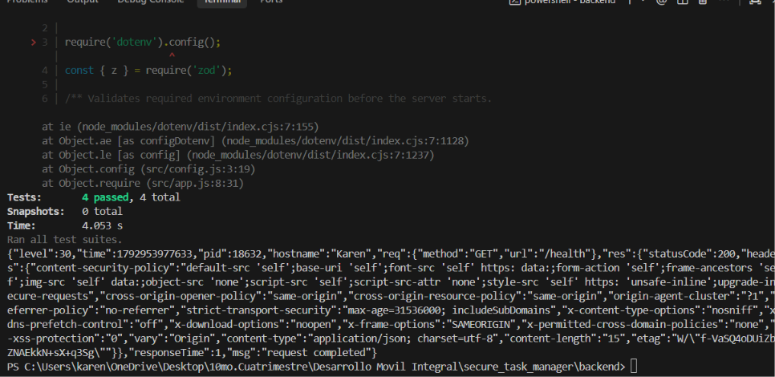
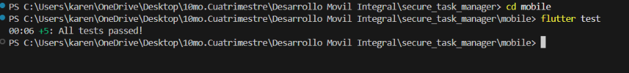
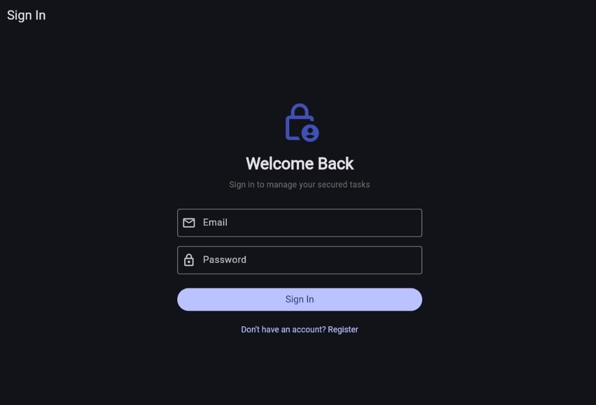
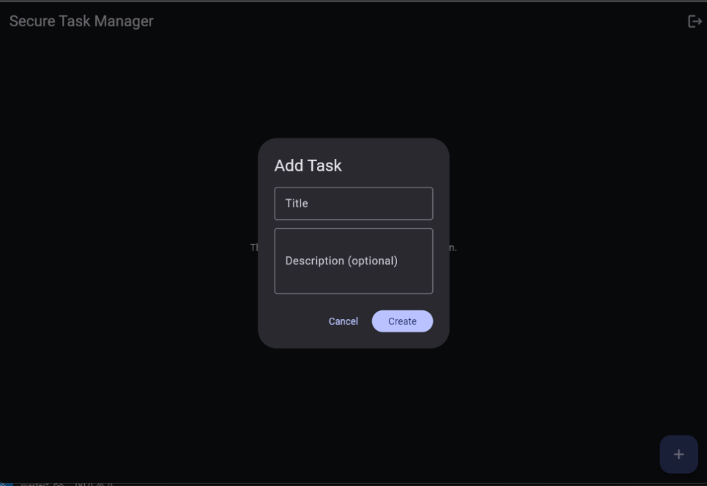

# Secure Task Manager with Flutter and Node.js

Aplicación Full-Stack de gestión de tareas con autenticación segura, rotación de refresh tokens, detección de reúso, control de acceso basado en pertenencia (prevención IDOR), backend en Node.js/Express con Prisma y PostgreSQL en Docker, y frontend móvil en Flutter con Riverpod y almacenamiento seguro.

---

## 🚀 Arquitectura y Tecnologías

- **Backend:**
  - Node.js (v24 LTS)
  - Express.js (v5)
  - PostgreSQL 16 (vía Docker Compose)
  - Prisma ORM (v6.4.1)
  - Autenticación con JWT (Access Tokens de 10 min y Refresh Tokens opacos de 7 días con hash SHA-256)
  - Seguridad: Helmet, CORS allowlist, Express Rate Limit, Zod schemas, BCrypt hashing
  - Tests: Jest, Supertest

- **Frontend (Mobile):**
  - Flutter SDK & Dart
  - Gestión de Estado: Riverpod (`flutter_riverpod`)
  - Almacenamiento Seguro: `flutter_secure_storage`
  - Cliente HTTP con interceptor automático para rotación de tokens y reintento único (`ApiClient`)
  - Tests: `flutter_test`, `mocktail`

---

## 🛠️ Instrucciones de Ejecución

### 1. Iniciar Base de Datos con Docker
Desde la raíz o desde la carpeta `backend`:
```bash
cd backend
docker compose up -d
```

### 2. Configurar y Levantar el Backend
```bash
cd backend
# Asegúrate de tener tu archivo .env configurado a partir de .env.example
npx prisma migrate dev
npm start
```
El servidor escuchará en `http://localhost:3000`.

### 3. Ejecutar Pruebas Automatizadas

**Backend:**
```bash
cd backend
npm test
```

**Flutter:**
```bash
cd mobile
flutter test
```

### 4. Ejecutar el Script de Verificación de Ejercicios (Sección 19a)
Desde la raíz del proyecto en PowerShell:
```powershell
powershell -ExecutionPolicy Bypass -File .\test_exercises.ps1
```

### 5. Iniciar la Aplicación Flutter
Desde la carpeta `mobile`:
```bash
cd mobile
# En emulador Android:
flutter run --dart-define=API_BASE_URL=http://10.0.2.2:3000/api/v1

# En Windows Desktop o Navegador Web:
flutter run -d chrome --dart-define=API_BASE_URL=http://localhost:3000/api/v1
# o
flutter run -d windows --dart-define=API_BASE_URL=http://localhost:3000/api/v1
```

---

## 📸 Evidencias de Pruebas Automatizadas

### Pruebas del Backend (Jest + Supertest)
```bash
cd backend
npm test
```
Resultados de las 4 pruebas unitarias y de integración del ciclo de vida de autenticación y salud:


### Pruebas del Frontend Móvil (Flutter Test)
```bash
cd mobile
flutter test
```
Resultados de las 5 pruebas unitarias y de widgets de Flutter:


### Aplicación Flutter en Ejecución (Pantalla de Autenticación)
```bash
cd mobile
flutter run -d chrome --dart-define=API_BASE_URL=http://localhost:3000/api/v1
```
Interfaz de inicio de sesión y registro en modo oscuro con diseño responsivo:


### Aplicación Flutter en Ejecución (Gestor de Tareas)
Pantalla principal con sesión iniciada, mostrando la vista de tareas, diálogo para crear nuevas tareas (`Add Task`) y acción de cierre de sesión:


---

## 📄 Documento de Evidencias
Consulte el archivo [`EVIDENCIAS.md`](./EVIDENCIAS.md) para ver la tabla completa de resultados de pruebas de seguridad, respuestas a preguntas de reflexión teórica y el resto de evidencias del proyecto.
